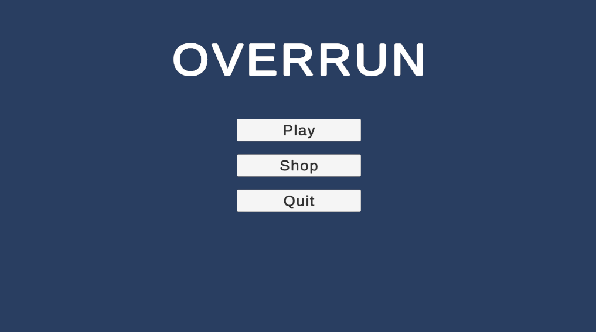
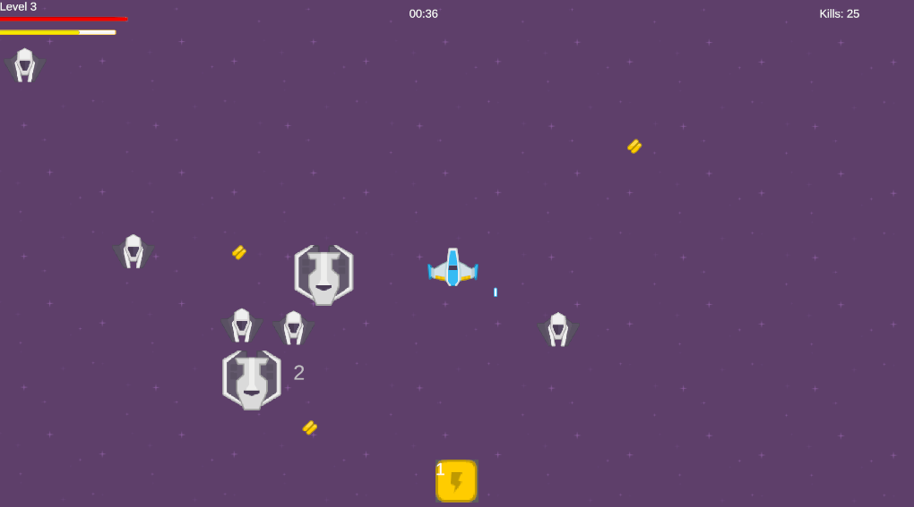
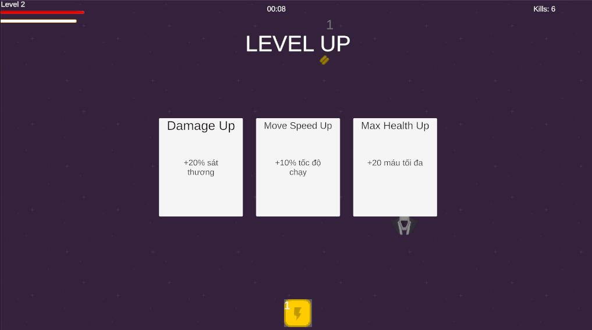
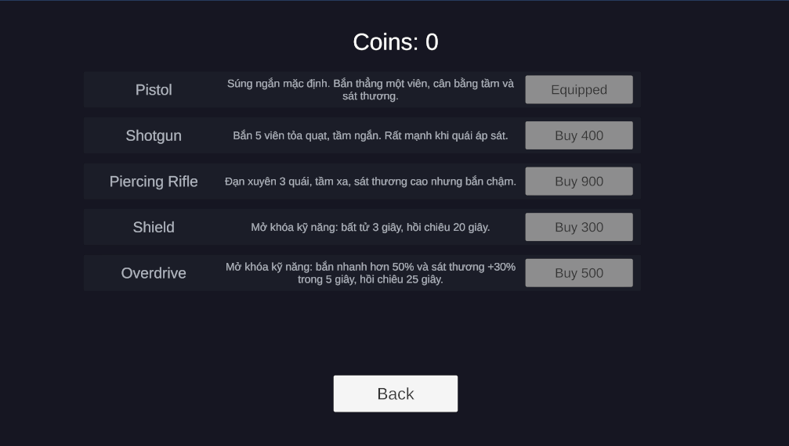
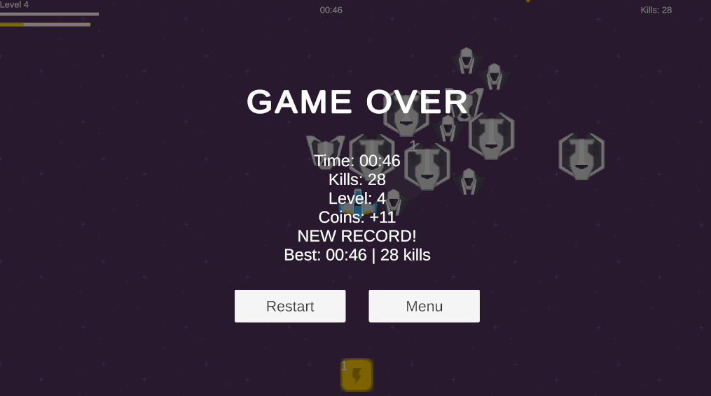
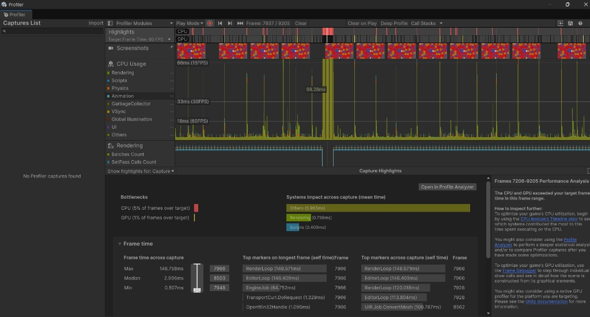
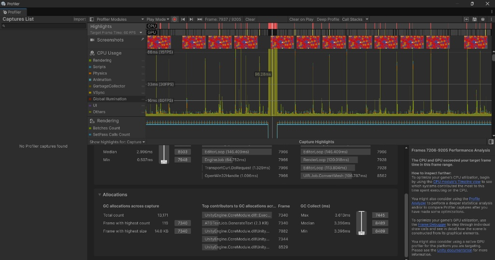

# OVERRUN

A small but complete **2D top-down horde survival game** built in **Unity 6 (C#)** in one week as a portfolio project. Survive for 5 minutes against ever-stronger waves, level up, pick upgrades, use abilities, and spend coins in a persistent shop between runs.

---

## Table of Contents

1. [Features](#features)
2. [How to Play](#how-to-play)
3. [Screenshots](#screenshots)
4. [Architecture and Technical Highlights](#architecture-and-technical-highlights)
5. [Performance Report](#performance-report)
6. [Project Structure](#project-structure)
7. [Build and Run](#build-and-run)
8. [Lessons Learned](#lessons-learned)
9. [Credits](#credits)

---

## Features

**Gameplay**
- Auto-firing weapon that targets the nearest enemy; the player only moves and makes decisions
- 3 enemy types: **Chaser** (balanced), **Fast** (fragile, quick), **Tank** (slow, durable)
- XP gems with a magnet radius, level-ups that pause the game and offer **1 of 3 random upgrades**
- 5 upgrade types: Damage, Fire Rate, Move Speed, Max HP, Magnet Radius
- 3 active abilities with cooldowns: **Sprint**, **Shield** (invulnerability), **Overdrive** (faster and stronger shooting)
- Win by surviving 5 minutes; lose when HP reaches 0
- **Time-based difficulty scaling**: enemy HP, speed and contact damage increase along designer-tunable curves, so the game stays challenging as the player gets stronger

**Meta progression**
- Coins awarded after every run (win or lose)
- **Shop** with 3 weapons (Pistol, Shotgun, Piercing Rifle) and ability unlocks (Shield, Overdrive)
- Equip system for weapons, JSON save/load (coins, owned items, equipped weapon, best time, best kills)
- High score shown on the result screen and main menu

**Game feel**
- Hit flash on enemies and player, screen shake when the player takes damage
- Pooled floating damage numbers (capped on screen to avoid clutter)
- Subtle fading death effect
- Music and SFX driven by gameplay events

---

## How to Play

| Input | Action |
|---|---|
| `W A S D` / Arrow keys / Gamepad stick | Move |
| `1`, `2`, `3` | Activate unlocked abilities (in unlock order) |
| Mouse | Menus, upgrade cards, shop |

The weapon fires automatically. Collect green gems to level up, choose an upgrade, and survive until the timer reaches 05:00.

---

## Screenshots

<!-- IMAGE 2: Main menu (with Best score text) -->


<!-- IMAGE 3: Gameplay with HUD (health bar, XP bar, level, timer, kills, ability bar) and many enemies -->


<!-- IMAGE 4: Level-up screen with 3 upgrade cards -->


<!-- IMAGE 5: Shop screen with weapons and abilities -->


<!-- IMAGE 6: Result screen (YOU WIN or GAME OVER with stats, coins, best) -->


---

## Architecture and Technical Highlights
### 1. Object Pooling
Enemies (one pool per type), projectiles, gems, damage numbers and death effects all use `UnityEngine.Pool.ObjectPool<T>`. Pooled objects subscribe to events in `OnEnable` and unsubscribe in `OnDisable` so re-use never causes duplicate subscriptions. Pool `actionOnDestroy` callbacks are null-safe to avoid errors when leaving Play mode.

### 2. ScriptableObject data-driven design
- `EnemyData`: stats and prefab per enemy type
- `UpgradeData`: a stat, a modifier mode and a value
- `AbilityData` (abstract) with `StatBoostAbility` and `InvincibilityAbility`
- `WeaponData`: damage/fire-rate multipliers, projectiles per shot, spread angle, pierce count, range
- `ShopItemData` and `ShopCatalog`

All three weapons run through **one** code path in `AutoWeapon`. Adding a new weapon means creating an asset, not writing a class.

### 3. Stat system with modifiers
`PlayerStats` stores base values and computes `(base + additive) * multiplicative`. Level-up upgrades and temporary ability buffs all go through `AddModifier` / `RemoveModifier`, so they stack correctly and expire without corrupting the base value.

### 4. Strategy pattern for abilities
`AbilityController` only manages input, cooldown and duration. What a skill does lives in the `AbilityData` subclass (`Activate` / `Deactivate`). New skills do not require changing the controller.

### 5. Game State Machine
`GameStateMachine` (Playing, LevelUp, Win, Lose) is the single place that controls pausing via `Time.timeScale`, and blocks invalid transitions (for example, Win and Lose are terminal so a simultaneous death and timeout cannot produce two results).

### 6. Event / Observer pattern
Static events (`Enemy.Died`, `Enemy.Damaged`, `GameEvents.LevelUp`) and instance events (`Health.OnHealthChanged`, `Experience.OnXpChanged`) keep the HUD, audio and effects fully decoupled from gameplay logic.

### 7. Persistent save and meta progression
`PlayerProfile` is a static service that saves JSON to `Application.persistentDataPath`. It handles missing or corrupted save files and stays backwards compatible when new fields are added.

### 8. Time-based difficulty scaling
`DifficultyScaler` evaluates `AnimationCurve`s over run progress (elapsed / win time) for enemy health, speed and damage. Values are passed to each newly spawned enemy through a small `readonly struct` (no allocations). Curves can be tuned in the Inspector without touching code.

---

## Performance Report

Measured with the Unity Profiler to verify that the pooling approach holds up with a large number of enemies.

### Testing conditions

- **Environment:** Unity Editor (Unity 6.6). Measured in the Editor, **not** in a standalone build, so a build should perform better.
- **Hardware:** Intel Core i7 (10th gen), NVIDIA GeForce RTX 2070, 32 GB RAM
- **Scenario:**
  - Player weapon **off**, so this isolates the **pure cost of the enemy system** (does not include player bullets or weapon VFX)
  - ~300 enemies alive at once (`Max Alive = 300`, `Spawn Interval = 0.05 s`)
  - Player HP set very high so the player survives for the whole capture
- **Sample size:** about 2,000 frames (frames 7206 to 9205)







### Results

| Metric | Value | Notes |
|---|---|---|
| Median frame time (CPU) | **~3.0 ms** (`2.996 ms`) | Roughly 330 FPS of CPU headroom |
| Frames at 60 FPS or better | **~95%** | Steady standard frame rate |
| Scripts time | **0.41 ms / frame** | Enemy AI, spawner and movement are lightweight |
| Rendering time | **0.80 ms / frame** | Light draw cost |
| GC Collect (median) | **3.4 ms** | Collections are short and infrequent |
| Main GC allocation source | **TextMeshPro (HUD)**, 2.3 KB in the worst frame | Caused by updating UI text |
| Gameplay systems (enemies, projectiles, gems) | **0 allocations** | Object Pooling keeps them out of the allocation list |

### About the 146 ms spike

Frame 7966 shows a spike of **146.75 ms**. The Timeline shows it comes entirely from `EditorLoop` (~146.4 ms) and `RenderLoop` (~146.5 ms), which are Unity Editor internals. It is **not caused by project code** and does not appear in a build.

### Follow-up measurements

The full original report is available in [docs/PERFORMANCE.md](docs/performance.md).

---

## Project Structure

```
Assets/
└── _Project/
    ├── Scripts/            # All gameplay code (see below)
    ├── Prefabs/            # Player, enemies, projectile, gem, UI, effects
    ├── ScriptableObjects/
    │   ├── Abilities/      # Sprint, Shield, Overdrive
    │   ├── Upgrades/       # 5 level-up upgrades
    │   ├── Weapons/        # Pistol, Shotgun, PiercingRifle
    │   └── Shop/           # Shop items and catalog
    ├── Scenes/             # MainMenu, Game
    ├── Art/
    └── Audio/
docs/
├── images/                 # README screenshots
├── PERFORMANCE.md
├── profiler-300-enemies.png
└── profiler-allocations.png
```

**Key scripts**

| Area | Scripts |
|---|---|
| Player | `PlayerMovement`, `PlayerStats`, `PlayerHealthSync`, `AutoWeapon`, `Projectile` |
| Enemies | `Enemy`, `EnemyData`, `EnemySpawner`, `DifficultyScaler` |
| Health and damage | `Health`, `IDamageable` |
| Progression | `Experience`, `Gem`, `GemSpawner`, `UpgradeData`, `UpgradeManager` |
| Abilities | `AbilityData`, `StatBoostAbility`, `InvincibilityAbility`, `AbilityController` |
| Game flow | `GameStateMachine`, `GameSession`, `GameEvents` |
| Meta | `PlayerProfile`, `SaveData`, `ShopCatalog`, `ShopItemData`, `WeaponData` |
| UI | `HudController`, `UpgradeSelectionUI`, `AbilitySlotUI`, `ResultScreenUI`, `MainMenuUI`, `ShopUI`, `ShopItemRowUI` |
| Feedback | `HitFlash`, `ScreenShake`, `DamageNumber(Spawner)`, `DeathEffect(Spawner)`, `AudioManager` |

---

## Build and Run

**Requirements**
- Unity **6000.6.7f1** (Unity 6.6)
- Universal 2D (URP) template
- Packages: Input System, Cinemachine, TextMeshPro

**Run in the Editor**
1. Clone the repo: `git clone https://github.com/khangduong205/overrun.git`
2. Open the folder with Unity Hub
3. Open `Assets/_Project/Scenes/MainMenu.unity` and press Play

**Build**
1. `File > Build Profiles`
2. Make sure both scenes are listed, with `MainMenu` at index 0 and `Game` at index 1
3. Select your platform and click Build

**Save file location (Windows):** `%userprofile%\AppData\LocalLow\<CompanyName>\Overrun\save.json`

---

## Lessons Learned

- **Balance is a systems problem.** Letting the player multiply stats while enemies stayed constant made the game easier over time. Adding curve-based enemy scaling fixed the difficulty curve.
- **A shop that sells the same stats as level-ups adds nothing.** I redesigned the shop around weapons and ability unlocks, which change how the game plays rather than just inflating numbers.
- **Data-driven weapons beat per-weapon classes.** Three weapons with different behavior share one implementation.
- **Pooling needs discipline.** Event subscriptions must live in `OnEnable`/`OnDisable`, and state must be fully reset on reuse, or you get double subscriptions and stale state.
- **Centralize pause logic.** One state machine owning `Time.timeScale` avoided frozen-game bugs between level-up, win, lose and restart.
- **Measure, then claim.** Profiler captures showed gameplay code at under 0.5 ms per frame and that UI text, not gameplay, was the remaining allocation source.

### Possible future work
- Boss encounter
- More weapons and enemy types
- Pause and settings menus
- Controller support for menus

---

## Credits

**Art:** Kenney Space Shooter Remastered (https://kenney.nl/assets/space-shooter-remastered), CC0

**Audio:**
| File | Author | Source | License |
|---|---|---|---|
| Background music | _author_ | _link_ | _CC0 / CC-BY 4.0_ |
| SFX | generated with jsfxr (https://sfxr.me) | | no copyright |

**Tools:** Unity 6, Cinemachine, TextMeshPro, Input System

---
