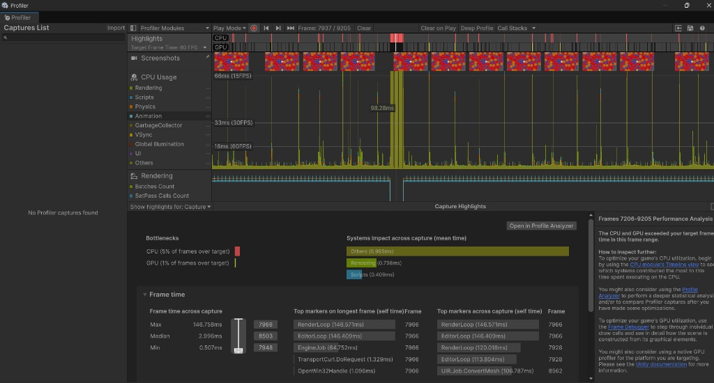
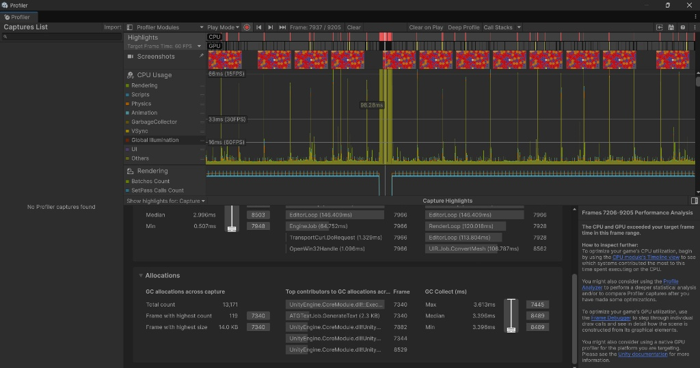

# Performance Report

This document records the performance benchmarks of the gameplay systems when handling a large number of enemies on screen.

---

## 1. Testing Conditions

* **Environment:** Unity Editor (Unity 6.6). *Note: measured directly in the Editor, not in a standalone build.*
* **Hardware:**
  * **CPU:** Intel Core i7 10th Gen
  * **GPU:** NVIDIA GeForce RTX 2070
  * **RAM:** 32 GB
* **Test scenario:**
  * **Weapon state:** **OFF** (measures the **pure cost of the enemy system**; excludes collisions, bullets and VFX from the player's weapon).
  * **Enemy count:** ~300 enemies alive at once (`Max Alive = 300`, `Spawn Interval = 0.05s`).
  * **Player state:** High HP (so the player survives for the entire test).
* **Sample size:**
  * About **2,000 frames** (frames 7206 to 9205).

---

## 2. Benchmark Results

| Metric | Value | Notes |
| :--- | :--- | :--- |
| **Median Frame Time (CPU)** | **~3.0 ms** (exactly `2.996 ms`) | Very smooth on average |
| **Frames at $\ge 60$ FPS** | **~95%** | Holds the standard frame rate |
| **Scripts Time** | **0.41 ms / frame** | Enemy movement and AI logic is well optimized |
| **Rendering Time** | **0.80 ms / frame** | Light rendering cost |
| **GC Collect (Median)** | **3.4 ms** | Garbage collections are infrequent and short |
| **Main GC Allocation** | **TextMeshPro (HUD)** (2.3 KB in the worst frame) | Allocations come mainly from updating UI strings |
| **Gameplay Systems** *(Enemies, Projectiles, Gems)* | **0 allocations** | No GC pressure thanks to consistent use of **Object Pooling** |

> **Recommendation:** Run a second measurement with the **weapon ON** and add a comparison column to the table above, to get figures closest to what players actually experience.

---

## 3. Note on the Spike (Frame Drop)

* **Peak spike:** Frame 7966 recorded a processing time of **146.75 ms**.
* **Cause:** Timeline analysis shows the spike comes entirely from Unity Editor's `EditorLoop` and `RenderLoop` (`EditorLoop`: ~146.4 ms, `RenderLoop`: ~146.5 ms).
* **Conclusion:** This spike is caused by the Editor's internal update mechanism and **does not originate from the project's code or logic**.
